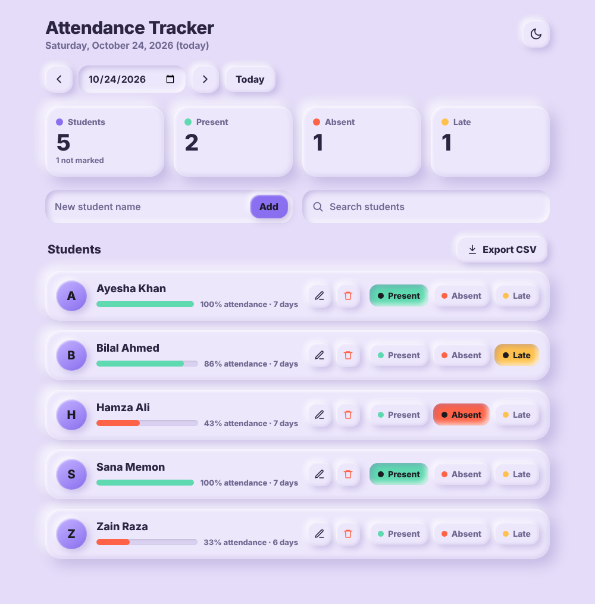
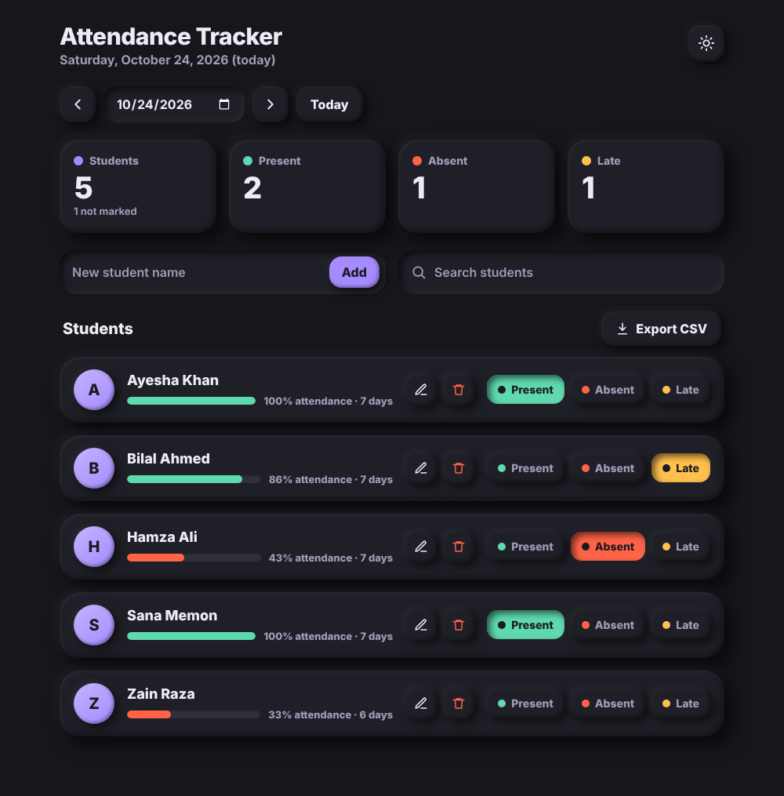

# Attendance Tracker

A simple web app to mark and review daily student attendance. Built with Flask, SQLite and plain HTML/CSS/JavaScript, with a soft "claymorphism" design and a dark mode.

| Light mode | Dark mode |
|---|---|
|  |  |

## Features

- Mark each student **Present**, **Absent** or **Late** for any date
- Date picker with previous day, next day and Today buttons
- Dashboard cards: total students, present, absent, late, and how many are not marked yet
- Attendance percentage bar for every student (green 75%+, amber 50-74%, red below 50%)
- Add, rename and delete students (duplicate and empty names are blocked)
- Live search
- Export all attendance records to a CSV file
- Light and dark mode (remembers your choice)
- Works on phones

## Tech stack

| Part | Technology |
|---|---|
| Back end | Python, Flask |
| Database | SQLite (`sqlite3` module) |
| Front end | HTML, CSS, vanilla JavaScript |

## Run it on your computer

You need Python 3.9 or newer.

```bash
# 1. Download the project
git clone https://github.com/<your-username>/attendance-tracker.git
cd attendance-tracker

# 2. Create and activate a virtual environment
python -m venv venv
venv\Scripts\activate          # Windows
# source venv/bin/activate     # macOS / Linux

# 3. Install the requirements
pip install -r requirements.txt

# 4. Start the app
python app.py
```

Open http://127.0.0.1:5000 in your browser. The database file `students.db` is created automatically the first time you run the app.

To open it from another device on the same Wi-Fi, use your computer's local IP address with port 5000, for example `http://192.168.1.10:5000`.

## Project structure

```
attendance-tracker/
├── app.py                  # Flask server, routes and database code
├── requirements.txt        # Python packages needed
├── templates/
│   └── index.html          # The page
├── static/
│   ├── css/style.css       # Design (colors, clay shadows, dark mode)
│   └── js/app.js           # Page logic (talks to the server)
└── docs/
    └── screenshots/        # Images used in this README
```

## Database

Two tables, created automatically:

- `students` (`id`, `name`)
- `attendance` (`id`, `student_id`, `date`, `status`), with one row per student per date

## API routes

| Method | Route | What it does |
|---|---|---|
| GET | `/` | The page |
| GET | `/students?date=YYYY-MM-DD` | Students with their status for that date and their attendance % |
| POST | `/add_student` | Add a student |
| PUT | `/students/<id>` | Rename a student |
| DELETE | `/students/<id>` | Delete a student and their records |
| POST | `/mark` | Set (or clear) a student's status for a date |
| GET | `/export` | Download all records as CSV |

## Known limitations

- There is no login yet, so anyone who can open the site can change the data. Do not publish it on the open internet as it is.
- Percentages count only the days where a student was marked.

## Roadmap

- [ ] Login system with hashed passwords
- [ ] Deploy online (PythonAnywhere or Railway)
- [ ] Classes / sections
- [ ] Automated tests

## Author

Zuhaib Khan, BE Software Engineering student at MUET Jamshoro.
